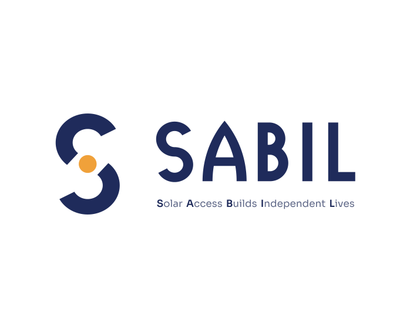
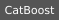
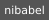

<picture>
  <source media="(prefers-color-scheme: dark)" srcset="https://github.com/YounesToukal/YounesToukal/raw/main/assets/opening-dark.svg">
  <source media="(prefers-color-scheme: light)" srcset="https://github.com/YounesToukal/YounesToukal/raw/main/assets/opening-light.svg">
  
</picture>

  <a href="mailto:younesstoukal2@gmail.com"><picture><source media="(prefers-color-scheme: dark)" srcset="https://github.com/YounesToukal/YounesToukal/raw/main/assets/contact-dark/email.svg"><source media="(prefers-color-scheme: light)" srcset="https://github.com/YounesToukal/YounesToukal/raw/main/assets/contact-light/email.svg"></picture></a>&nbsp;
  <a href="https://www.linkedin.com/in/younes-toukal/"><picture><source media="(prefers-color-scheme: dark)" srcset="https://github.com/YounesToukal/YounesToukal/raw/main/assets/contact-dark/linkedin.svg"><source media="(prefers-color-scheme: light)" srcset="https://github.com/YounesToukal/YounesToukal/raw/main/assets/contact-light/linkedin.svg"></picture></a>&nbsp;
  <a href="https://younestoukal.github.io"><picture><source media="(prefers-color-scheme: dark)" srcset="https://github.com/YounesToukal/YounesToukal/raw/main/assets/contact-dark/website.svg"><source media="(prefers-color-scheme: light)" srcset="https://github.com/YounesToukal/YounesToukal/raw/main/assets/contact-light/website.svg"></picture></a>

I hold a master's degree in Visual Computing and a bachelor's degree in Computer Science. I am interested in machine learning for health, computer vision, three-dimensional vision and technology for underserved communities. Along the way, I have taken part in the [Deep Learning Indaba](https://deeplearningindaba.com/2026/), the [African Computer Vision Summer School](https://www.acvss.ai/) and the AI Forge program, and I taught computer vision to students at [Micro Club](https://www.microclub.info/).

### Projects

**[Hepatic vessel segmentation](https://github.com/YounesToukal/context-aware-hepatic-vessel-segmentation)** · *Health* 
Segments the liver's blood vessels in computed tomography scans to support liver surgery planning.

 

<a href="https://github.com/YounesToukal/SABIL"><picture><source media="(prefers-color-scheme: dark)" srcset="https://github.com/YounesToukal/YounesToukal/raw/main/assets/projects/sabil-tile-reversed.svg"><source media="(prefers-color-scheme: light)" srcset="https://github.com/YounesToukal/YounesToukal/raw/main/assets/projects/sabil-tile-colour.svg"></picture></a>

**[SABIL](https://github.com/YounesToukal/SABIL)** · *Energy access* 
A home solar kit that protects its battery, for families who lose the electricity grid for months.

 

**[QuranDec](https://github.com/YounesToukal/QuranicSchool)** · *Community education* 
A bilingual Arabic and French web application for following each student's progress in a Quranic school.

 

### Tools I work with

- **Languages** &nbsp; &nbsp; &nbsp; &nbsp; 
- **Machine learning** &nbsp; &nbsp; &nbsp; &nbsp; 
- **Vision and imaging** &nbsp; &nbsp; 
- **Data and plotting** &nbsp; &nbsp; &nbsp; 

<picture>
  <source media="(prefers-color-scheme: dark)" srcset="https://github.com/YounesToukal/YounesToukal/raw/main/assets/close-dark.svg">
  <source media="(prefers-color-scheme: light)" srcset="https://github.com/YounesToukal/YounesToukal/raw/main/assets/close-light.svg">
  
</picture>
