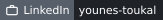
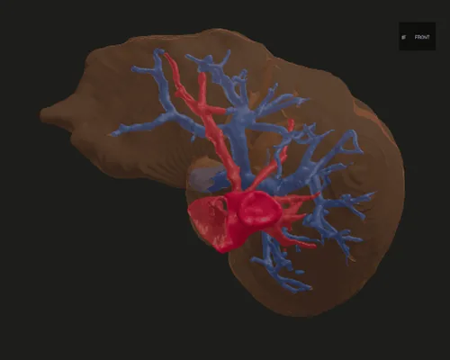
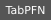
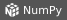
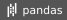
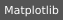

<picture>
  <source media="(prefers-color-scheme: dark)" srcset="https://github.com/YounesToukal/YounesToukal/raw/main/assets/opening-dark.svg">
  <source media="(prefers-color-scheme: light)" srcset="https://github.com/YounesToukal/YounesToukal/raw/main/assets/opening-light.svg">
  
</picture>

  <a href="mailto:younesstoukal2@gmail.com"><picture><source media="(prefers-color-scheme: dark)" srcset="https://github.com/YounesToukal/YounesToukal/raw/main/assets/contact-dark/email.svg"><source media="(prefers-color-scheme: light)" srcset="https://github.com/YounesToukal/YounesToukal/raw/main/assets/contact-light/email.svg"></picture></a>&nbsp;
  <a href="https://www.linkedin.com/in/younes-toukal/"><picture><source media="(prefers-color-scheme: dark)" srcset="https://github.com/YounesToukal/YounesToukal/raw/main/assets/contact-dark/linkedin.svg"><source media="(prefers-color-scheme: light)" srcset="https://github.com/YounesToukal/YounesToukal/raw/main/assets/contact-light/linkedin.svg"></picture></a>&nbsp;
  <a href="https://younestoukal.github.io"><picture><source media="(prefers-color-scheme: dark)" srcset="https://github.com/YounesToukal/YounesToukal/raw/main/assets/contact-dark/website.svg"><source media="(prefers-color-scheme: light)" srcset="https://github.com/YounesToukal/YounesToukal/raw/main/assets/contact-light/website.svg"></picture></a>

  I hold a master's degree in Visual Computing and a bachelor's degree in Computer Science. 
  I am interested in machine learning for health, computer vision, three-dimensional vision and technology for underserved communities.

<h3 align="center">Projects</h3>

<table>
  <tr>
    <td align="center" width="33%">
      
    </td>
    <td align="center" width="33%">
      <a href="https://github.com/YounesToukal/SABIL">
        <picture>
          <source media="(prefers-color-scheme: dark)" srcset="https://github.com/YounesToukal/YounesToukal/raw/main/assets/projects/sabil-tile-reversed.svg">
          <source media="(prefers-color-scheme: light)" srcset="https://github.com/YounesToukal/YounesToukal/raw/main/assets/projects/sabil-tile-colour.svg">
          
        </picture>
      </a>
    </td>
    <td align="center" width="33%">
      
    </td>
  </tr>
  <tr>
    <td valign="top" width="33%">
      <b><a href="https://github.com/YounesToukal/context-aware-hepatic-vessel-segmentation">Hepatic vessel segmentation</a></b> 
      <i>Health</i> 
      Segments the liver's blood vessels in computed tomography scans to support liver surgery planning.
    </td>
    <td valign="top" width="33%">
      <b><a href="https://github.com/YounesToukal/SABIL">SABIL</a></b> 
      <i>Energy access</i> 
      A home solar kit that protects its battery, for families who lose the electricity grid for months.
    </td>
    <td valign="top" width="33%">
      <b><a href="https://github.com/YounesToukal/QuranicSchool">QuranDec</a></b> 
      <i>Community education</i> 
      A bilingual Arabic and French web application for following each student's progress in a Quranic school.
    </td>
  </tr>
</table>

<h3 align="center">Activities</h3>

<table align="center">
  <tr>
    <td align="center" valign="top" width="50%"><b>2026</b> Deep Learning Indaba Participant and poster reviewer <i>Lagos, Nigeria</i></td>
    <td align="center" valign="top" width="50%"><b>2026</b> African Computer Vision Summer School Participant in a team computer vision project <i>Accra, Ghana</i></td>
  </tr>
  <tr>
    <td align="center" valign="top" width="50%"><b>2025</b> AI Forge program Team project on space debris detection <i>Algiers, Algeria</i></td>
    <td align="center" valign="top" width="50%"><b>2022 to 2025</b> Micro Club Computer vision tutor to about 100 members <i>Algiers, Algeria</i></td>
  </tr>
</table>

<h3 align="center">Tools I work with</h3>

<table align="center">
  <tr>
    <td><b>Languages</b></td>
    <td>&nbsp; &nbsp; &nbsp; </td>
  </tr>
  <tr>
    <td><b>Machine learning</b></td>
    <td>&nbsp; &nbsp; &nbsp; </td>
  </tr>
  <tr>
    <td><b>Vision and imaging</b></td>
    <td>&nbsp; </td>
  </tr>
  <tr>
    <td><b>Data and plotting</b></td>
    <td>&nbsp; &nbsp; </td>
  </tr>
</table>

<picture>
  <source media="(prefers-color-scheme: dark)" srcset="https://github.com/YounesToukal/YounesToukal/raw/main/assets/close-dark.svg">
  <source media="(prefers-color-scheme: light)" srcset="https://github.com/YounesToukal/YounesToukal/raw/main/assets/close-light.svg">
  
</picture>
