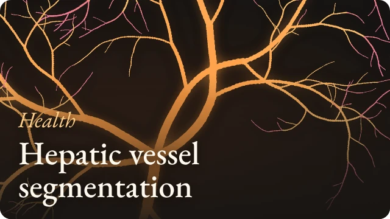
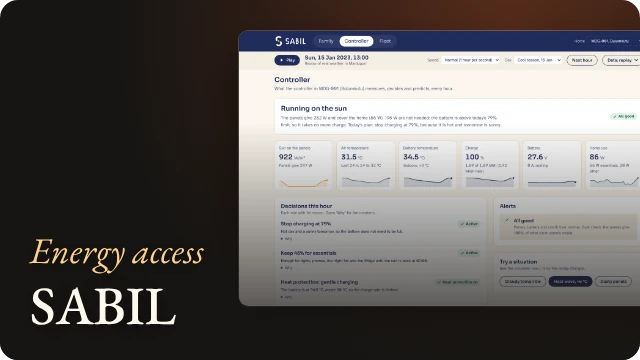
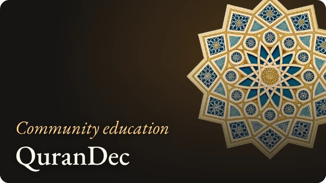

  

  <i>I build machine learning and software for people who are usually left out of technology, in health, energy access and education, and I share what I learn openly so others can build on it.</i>

  &nbsp;
  &nbsp;
  

  I hold a master's degree in Visual Computing and a bachelor's degree in Computer Science. 
  I am interested in machine learning for health, computer vision, three-dimensional vision and technology for underserved communities.

<h3 align="center">Projects</h3>

<table>
  <tr>
    <td width="33%" valign="top">
      
       Segments the liver's blood vessels in computed tomography scans for liver surgery planning, reading neighbouring slices together for three-dimensional context.
    </td>
    <td width="33%" valign="top">
      
       A home solar kit for families who lose the electricity grid for months. In a ten-year simulation, hours without essential power fall from 110 to 13.
    </td>
    <td width="33%" valign="top">
      
       A bilingual Arabic and French web application that helps a Quranic school follow each student's progress, even offline.
    </td>
  </tr>
</table>

<h3 align="center">Community</h3>

<table align="center">
  <tr>
    <td align="center" width="25%"><b>2026</b> Deep Learning Indaba Lagos, Nigeria</td>
    <td align="center" width="25%"><b>2026</b> African Computer Vision Summer School Accra, Ghana</td>
    <td align="center" width="25%"><b>2025</b> AI Forge program World Learning Algeria</td>
    <td align="center" width="25%"><b>2022 to 2025</b> Computer vision tutor Micro Club</td>
  </tr>
</table>

<h3 align="center">Tools I work with</h3>

  &nbsp;
  &nbsp;
  &nbsp;
  
 
  &nbsp;
  &nbsp;
  &nbsp;
  &nbsp;
  
 
  &nbsp;
  &nbsp;
  &nbsp;
  

  

