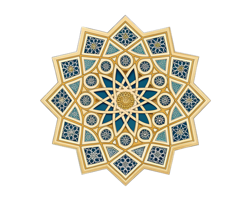

<picture>
  <source media="(prefers-color-scheme: dark)" srcset="https://github.com/YounesToukal/YounesToukal/raw/main/assets/lead-mona-dark.svg">
  <source media="(prefers-color-scheme: light)" srcset="https://github.com/YounesToukal/YounesToukal/raw/main/assets/lead-mona-light.svg">
  
</picture>

I hold a master's degree in Visual Computing and a bachelor's degree in Computer Science. I have taken part in the [Deep Learning Indaba](https://deeplearningindaba.com/2026/), the [African Computer Vision Summer School](https://www.acvss.ai/) and the AI Forge program, and I taught computer vision at [Micro Club](https://www.microclub.info/). I share my work openly so that others can build on it.

### Projects

**[Hepatic vessel segmentation](https://github.com/YounesToukal/context-aware-hepatic-vessel-segmentation)** · *Health* 
Segments the liver's blood vessels in computed tomography scans to support liver surgery planning.

 

<a href="https://github.com/YounesToukal/SABIL"><picture><source media="(prefers-color-scheme: dark)" srcset="https://github.com/YounesToukal/YounesToukal/raw/main/assets/projects/sabil-tile-reversed.svg"><source media="(prefers-color-scheme: light)" srcset="https://github.com/YounesToukal/YounesToukal/raw/main/assets/projects/sabil-tile-colour.svg"></picture></a>

**[SABIL](https://github.com/YounesToukal/SABIL)** · *Energy access* 
A home solar kit that protects its battery, for families who lose the electricity grid for months.

 

**[QuranDec](https://github.com/YounesToukal/QuranicSchool)** · *Community education* 
A bilingual Arabic and French web application for following each student's progress in a Quranic school.

 

### Tools

- **Languages:** Python, C, C++, SQL
- **Machine learning:** PyTorch, TensorFlow, CatBoost, TabPFN
- **Vision and imaging:** OpenCV, nibabel
- **Data and plotting:** NumPy, pandas, Matplotlib

### Links

- Email: [younesstoukal2@gmail.com](mailto:younesstoukal2@gmail.com)
- LinkedIn: [in/younes-toukal](https://www.linkedin.com/in/younes-toukal/)
- Website: [younestoukal.github.io](https://younestoukal.github.io)

<picture>
  <source media="(prefers-color-scheme: dark)" srcset="https://github.com/YounesToukal/YounesToukal/raw/main/assets/close-dark.svg">
  <source media="(prefers-color-scheme: light)" srcset="https://github.com/YounesToukal/YounesToukal/raw/main/assets/close-light.svg">
  
</picture>
